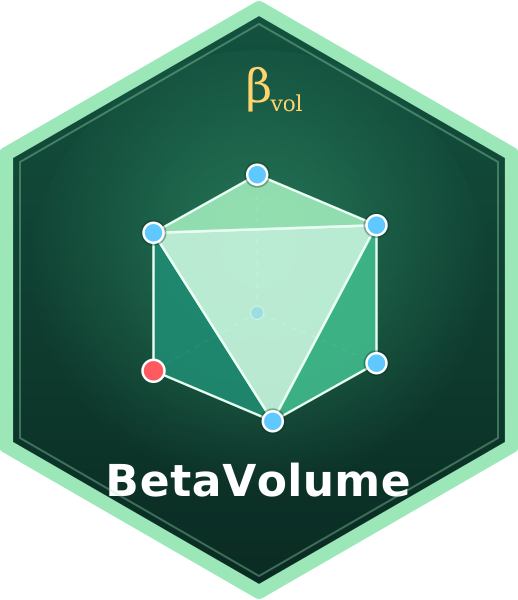

<!-- README.md is generated from README.Rmd. Please edit that file -->

```{r, include = FALSE}
knitr::opts_chunk$set(
  collapse = TRUE,
  comment = "#>",
  fig.path = "man/figures/README-",
  out.width = "100%"
)
```

# BetaVolume 

<!-- badges: start -->
[](https://github.com/clsong/BetaVolume/actions/workflows/R-CMD-check.yaml)
[](https://github.com/clsong/BetaVolume/actions/workflows/julia.yaml)
<!-- badges: end -->

BetaVolume implements the **geometric approach to beta diversity**, in both **R** and **Julia**, of
[Song et al. (2025, *Ecological Monographs*)](https://doi.org/10.1002/ecm.70008).
A metacommunity matrix (communities × species) is embedded as a cloud of
points in a hyper-dimensional space. Beta diversity is the rescaled
hypervolume of the convex hull spanned by the points and the origin:

$$\beta_{vol} = d \times \mathrm{vol}(P)^{1/d}, \qquad d = \min(\gamma, N).$$

$\beta_{vol}$ is an effective number of communities between 0 (all
communities identical) and $d$. Unlike classic measures, adding a distinct,
species-rich community to a metacommunity *increases* beta diversity, so the
measure accounts for species associations and non-additivity.

## Two implementations: R and Julia

BetaVolume is available in **two languages**, with the same methods and
matching results:

| | **R package** | **Julia package** |
|:--|:--|:--|
| Location | repository root | [`julia/`](julia/) |
| Install | `pak::pak("clsong/BetaVolume")` | `Pkg.add(url = "https://github.com/clsong/BetaVolume", subdir = "julia")` |
| Load | `library(BetaVolume)` | `using BetaVolume` |
| Requirements | R ≥ 3.5 | Julia ≥ 1.10 |
| Documentation | help pages, `vignette("BetaVolume")` | docstrings, [`julia/README.md`](julia/README.md) |
| Best for | everyday analyses, the R ecosystem | very large analyses, multithreaded exact contributions |

The R package is the reference implementation. The Julia package is tested
against values computed in R (32 reference matrices, agreement to about
1e-8), so both give the same answers.

### Installation

**R**

```r
# install.packages("pak")
pak::pak("clsong/BetaVolume")
```

**Julia**

```julia
using Pkg
Pkg.add(url = "https://github.com/clsong/BetaVolume", subdir = "julia")
```

### The same example in both languages

Fig. 1 of the paper: two species, A and B. Metacommunity I has the
communities {A} and {B}; metacommunity II adds {A, B}.

**R**

```{r example}
library(BetaVolume)

meta_I <- rbind(c(1, 0), c(0, 1))
meta_II <- rbind(c(1, 0), c(0, 1), c(1, 1))
betavolume(meta_I)
betavolume(meta_II) # adding a distinct, species-rich community increases beta
```

**Julia**

```julia
using BetaVolume

meta_I  = [1 0; 0 1]
meta_II = [1 0; 0 1; 1 1]
betavolume(meta_I)    # 1.4142135623730951
betavolume(meta_II)   # 2.0
```

Contributions of the three unique compositions of Fig. 4 and 6 (0.16, 0.37
and 0.47):

**R**

```{r}
fig4 <- rbind(c(1, 0), c(0, 1), c(0, 1), c(1, 1), c(1, 1), c(1, 1))
round(disentangle_individual_contribution(fig4, weights = TRUE), 3)
```

**Julia**

```julia
fig4 = [1 0; 0 1; 0 1; 1 1; 1 1; 1 1]
c = contributions(fig4; weights = true)
round.(c.values, digits = 3)   # [0.162, 0.372, 0.466]
c.units                        # [[1], [2, 3], [4, 5, 6]]
```

### More with the R package

We now analyse an empirical metacommunity from A. H. Gentry's forest
transect data, with 37 species recorded in 10 plots:

```{r}
dim(example_meta_composition)
betavolume(example_meta_composition)
```

With presence/absence data, duplicated compositions can be weighted by their
frequency (Eq. 5 of the paper):

```{r}
betavolume(example_meta_composition, weights = TRUE)
```

Which species contribute the most to beta diversity?

```{r}
contribution <- disentangle_individual_contribution(example_meta_composition)
round(head(sort(contribution, decreasing = TRUE)), 3)
```

## Functions in both languages

| R | Julia | Purpose | Paper |
|:--|:--|:--|:--|
| `betavolume()` | `betavolume()` | Geometric beta diversity: exact convex hull or fast hyper-normal approximation | Eq. 4, Box 1 |
| `preprocess_meta_composition()` | `preprocess()` | Orientation of the matrix and weighted embedding of duplicated presence/absence compositions | Eq. 5, Fig. 4 |
| `disentangle_individual_contribution()` | `contributions()` | Contribution of each community (or species) to beta diversity | Eq. 7, Fig. 6 |
| `get_compressed_angle()` | `compressed_angle()` | Rescaling by species similarity or functional complementarity | Eqs. 8–9, Fig. 7 |
| `beta_temporal_overlap()` | `temporal_overlap()` | Temporal change of beta diversity as (oriented) hypervolume overlap | Eq. 6, Fig. 5 |

The R function names also work in Julia (for example
`disentangle_individual_contribution`), so code translates directly.

The exact method is practical up to about 10–15 dimensions; by default
`betavolume()` switches to the hyper-normal approximation
($4\,d\,\det(\Sigma)^{1/d}$) above `dim_threshold = 10`. The approximation
scales to thousands of species or sites and accepts sparse matrices.

See `vignette("BetaVolume")` for a guided tour that reproduces the worked
examples of the paper.

## Performance

**R, version 0.2.0 vs 0.1.0.** Version 0.2.0 removes the dependency on
dplyr/tidyr/tibble/purrr and replaces the per-point recomputations of version
0.1.0 with faster algorithms. Median timings on one core
(`benchmarks/benchmark_r.R`):

| task | v0.1.0 | v0.2.0 | speed-up |
|:--|--:|--:|--:|
| `betavolume()`, example data, weights | 0.087 s | 0.021 s | 4× |
| `disentangle_individual_contribution()`, 60 × 6 binary (exact) | 0.35 s | 0.074 s | 5× |
| `disentangle_individual_contribution()`, 1000 × 50 (hyper-normal) | 2.35 s | 0.004 s | ~600× |

**R vs Julia.** The same matrices in both languages
(`julia/benchmark/`):

| task | R | Julia, 1 thread | Julia, 4 threads |
|:--|--:|--:|--:|
| beta diversity, hyper-normal, 2000 × 200 | 33 ms | 7.3 ms | 3.3 ms |
| contributions, hyper-normal, 2000 × 100 | 20 ms | 4.6 ms | 6.7 ms |
| contributions, exact, 200 × 8 binary, weights | 123 s | 139 s | 45 s |
| beta diversity, exact, 200 × 8 binary, weights | 0.91 s | 1.27 s | 1.07 s |

The hyper-normal method is 3–10× faster in Julia. The exact method spends
almost all of its time in the Qhull library, which both languages share, so
a single hull takes about as long in each. Exact contributions are about 3×
faster in Julia with 4 threads (`JULIA_NUM_THREADS=4`); in R, set the
`cores` argument to recompute hulls in parallel.

## Changes in version 0.2.0

Version 0.2.0 fixes several bugs of version 0.1.0 and aligns the package
with the published equations. See [NEWS.md](NEWS.md) for details. In
particular, `betavolume(weights = TRUE)` now uses the weights of Eq. 5
(`weight_scheme = "legacy"` reproduces older results), and the exact method
no longer silently returns 0 on degenerate presence/absence data.

## Citation

If you use BetaVolume, please cite (see also `citation("BetaVolume")`):

Song, C., Lu, M., Bennett, J. R., Gilbert, B., Fortin, M.-J., & Gonzalez, A.
(2025). A geometric approach to beta diversity. *Ecological Monographs*,
95(1), e70008. <https://doi.org/10.1002/ecm.70008>
